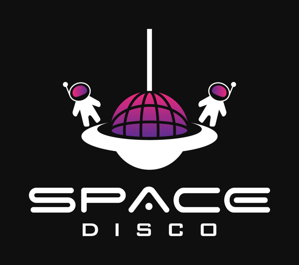

<p align="center">
  
</p>

<h1 align="center">communicator</h1>

<p align="center"><strong>Space Disco Communicator & Discotronic Flight Assistant: an Ember + Cordova app shell.</strong></p>

<p align="center"><em>"We are going to space and we are bringing a disco."</em> 🚀🪩</p>

> **Status:** Scaffold only. · **Visibility:** public · **Language:** JavaScript · **History:** 2020-01-16 → 2020-02-09, 2 commits

## 🪩 What this is

Ember CLI 2.15 app packaged with corber (Cordova) for iOS, with Space Disco icons. The only UI is the heading "Space Disco / Communicator / & Discotronic Flight Assitant". It was the start of a crew-member mobile app.

## 🎛️ Stack

- Ember CLI 2.15
- corber + Cordova (iOS icons and config)
- QUnit tests (generated)

## 🗺️ Layout

| Path | What it does |
| --- | --- |
| `app/templates/application.hbs` | the single screen |
| `corber/` | Cordova project and icons |
| `config/` | Ember environment |

## 🚀 Launch sequence (local setup)

```bash
npm install
npx ember serve   # http://localhost:4200
```

## 🛸 Deploy

None. 7 open Dependabot PRs (bumps for qs, lodash, js-yaml, shell-quote, sha.js, on-headers, pbkdf2) were opened between Jun 2025 and Feb 2026.

## 🔌 Integrations

None.

## 🧪 Tests & CI

Generated QUnit tests only.

## 🛰️ Current state

Scaffold only. Not deployable as-is on modern Node. 7 open Dependabot PRs.

## 🌌 How it connects

Companion idea for the Space Disco crew-member community (SMS check-in and boarding passes).

---

<p align="center"><sub>Space Disco · Orbital Lounge and House Music Club · Deep, Minimal, Tech House &amp; Soulful, Groovy, Funky, Disco House.<br>Documentation refreshed November 2026 from a read of the code and history.</sub></p>
